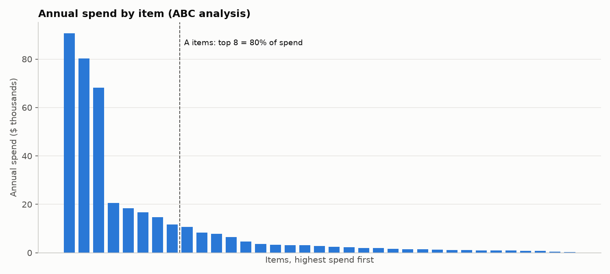
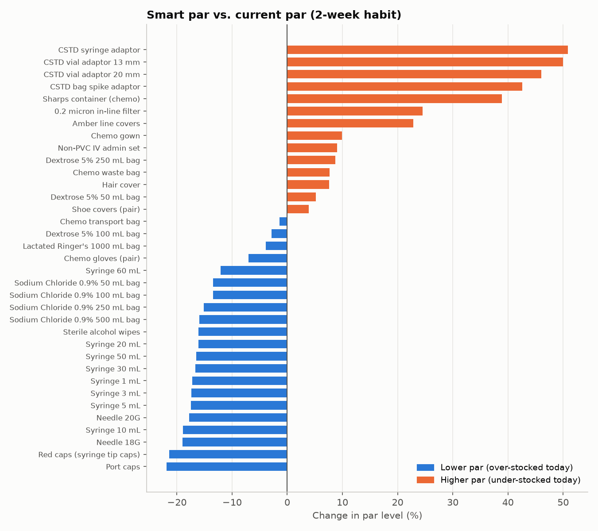
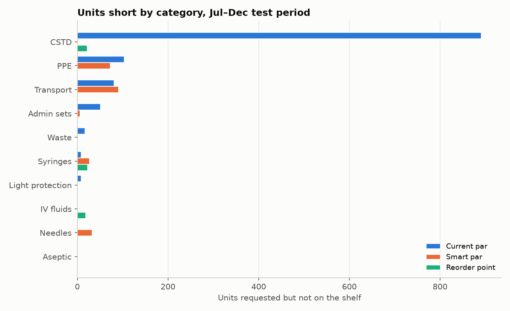

# Pharmacy Inventory Optimization: Par Levels vs. Statistics

**Question:** In an oncology compounding room, does a "keep two weeks on the shelf" par level hold up, or do statistically set par levels and reorder points do better?

**Answer:** The two-week habit fails in both directions. It over-stocks fast-moving, next-day supplies and under-stocks the long-lead-time items that matter most.

*Built by a pharmacy technician with 10+ years in oncology compounding, drug ordering and cycle counts. All data is synthetic.*

## Key findings (Jul–Dec 2025 test period, 35 supplies)

| Policy | Units short | Items that ran out | Avg inventory value | Orders | Holding + ordering cost |
|---|---|---|---|---|---|
| Current par (2 weeks, every item) | 1,163 | 12 | $6,777 | 910 | $3,584 |
| Smart par (same Monday routine, statistical par) | 231 | 7 | $10,871 | 910 | $4,100 |
| Daily reorder point + EOQ | 64 | 5 | $11,949 | 335 | $2,511 |

1. **77% of shortages under the habit were CSTD adaptors** (891 of 1,163 units). They have a 7-day, unreliable lead time, and a two-week par can't cover a one-week order cycle plus a one-week delivery.
2. **Smart par keeps the weekly routine but fixes the numbers.** It lowers par on 21 items (fast movers like port caps, red caps and needles, down about 20%) and raises it on 14 (CSTD adaptors up 43–51%). Shortages fall 80%.
3. **Being in stock costs money.** Average inventory rises about $4,100, almost all of it in CSTD adaptors. That's the price of not running out of the most critical items.
4. **Daily reorder points have the fewest shortages (down 94%) and the lowest operating cost**, with 63% fewer orders. But they need a perpetual inventory count, which is a process change, not just a math change.
5. **Four CSTD items are about 65% of annual spend** (ABC analysis), so they deserve the closest management.





## Sensitivity tests

| Current par habit | Units short | Items that ran out | Fill rate | Avg inventory value |
|---|---|---|---|---|
| 1.5 weeks | 5,071 | 26 | 96.0% | $4,039 |
| 2 weeks (base) | 1,163 | 12 | 99.1% | $6,777 |
| 3 weeks | 0 | 0 | 100% | $13,972 |

A one-size par can eliminate shortages, but only by keeping 3 weeks of everything (about $14,000). Raising smart par's service level from 80% to 99.5% cuts units short from 1,324 to 12 but raises inventory from $7,916 to $14,471. The right target is a management trade-off between shelf dollars and stockout risk.

## Approach

1. **Data:** 365 days of synthetic usage for 35 compounding supplies. Demand follows a negative binomial distribution (lumpy, like real usage), Mondays are about 32% busier than Fridays, and the clinic is closed weekends and holidays.
2. **Train/test split:** every setting is learned from Jan–Jun and tested on Jul–Dec, months the formulas never saw.
3. **Formulas** (`src/inventory.py`):
   - Safety stock = z × √(L·σd² + d²·σL²), covering both usage swings and late deliveries
   - Reorder point = d·L + safety stock
   - EOQ = √(2DS/H)
   - Smart par = d·(R+L) + z × √((R+L)·σd² + d²·σL²)
4. **Simulation** (`src/simulate.py`): replays each day: receive deliveries, fill demand, decide whether to order. It uses inventory position (on hand + on order) so it never double-orders.

## Validation

- Formulas match an independent Excel calculation and a hand calculation (CSTD syringe adaptor: safety stock 189.4, reorder point 417.4).
- The simulation matches a 5-day hand trace (9 units short, 74.3% fill rate), checked automatically in `tests/test_simulate.py`.
- 11 unit tests pass (`pytest -q`).
- Measuring variability on raw daily data (weekends included) instead of weekly totals would add about $500 of inventory, so small method choices change real dollars.

## Assumptions

| Assumption | Value | Why |
|---|---|---|
| Order cost | $3 per order line | One daily wholesaler order covers many lines, so each extra line costs little |
| Holding cost | 25% of value per year | Industry rule of thumb (capital, space, expiry) |
| Service level | 95% | Common starting point; tested from 80% to 99.5% |
| Order size limits | 0.5–4 weeks of usage | Shelf space and expiry |
| Variability | Measured on weekly totals | Daily data includes predictable weekend zeros |

## Limitations

- **The data is synthetic.** Real usage has regimen changes, seasonal trends and drug shortages, which aren't modeled here.
- **Bench reality check:** in practice, 50 mL and 60 mL syringes are among the most-used supplies (about 200 per week, because many chemo regimens go out on pumps), and red caps are used far less. The synthetic volumes don't fully reflect a real infusion center.
- Units short counts every item the same. A missing CSTD adaptor matters more than a missing hair cover.
- Case-pack rounding (for example, syringes sold in boxes of 100) isn't modeled.

## Repo structure

```
data/                 synthetic items and daily usage
notebooks/01_eda.ipynb              exploring the data
notebooks/02_policy_results.ipynb   results, charts, sensitivity, validation
src/generate_data.py  creates the synthetic data
src/inventory.py      inventory formulas
src/simulate.py       day-by-day simulation
src/run_analysis.py   compares the three policies, saves results and charts
examples/what_if.py   test par levels for one item with your own usage numbers
tests/                11 unit tests
```

## Run it

```bash
python -m venv .venv
.venv\Scripts\activate          # Mac/Linux: source .venv/bin/activate
pip install -r requirements.txt
python src/generate_data.py
python src/run_analysis.py
pytest -q
```

*All data is synthetic and was created for this project. No patient, employer or pricing data is used.*
